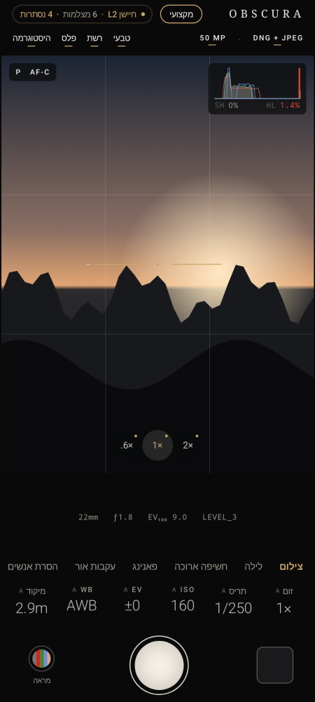
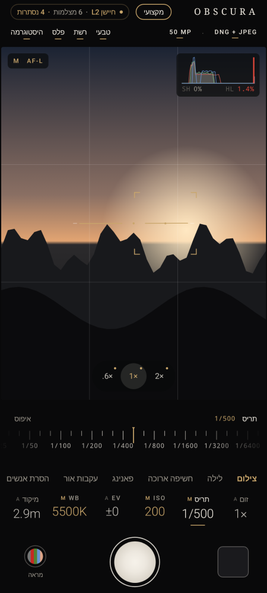
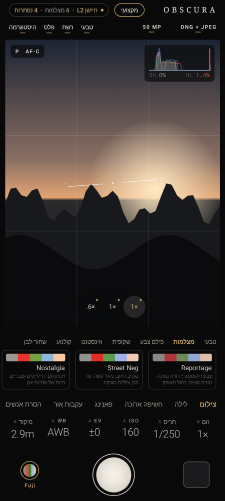
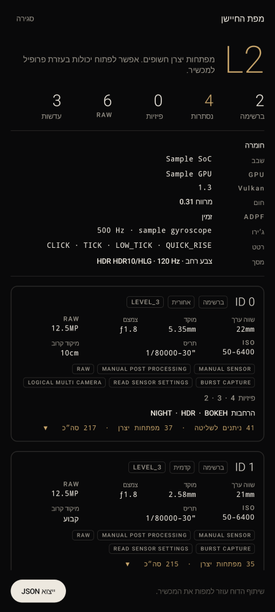

# Obscura: מצלמה מקצועית לאנדרואיד

מצלמה לצלמים מקצועיים שמנצחת את המצלמה המובנית בעזרת צינור עיבוד RAW משלה:
- פתיחה של מצבי חיישן ועדשות שהיצרן מסתיר, לפי פרופיל לכל מכשיר.
- צילום רצף ומיזוג (HDR+ / MFSR).
- סימולציית פילם ספקטרלית.
- תצוגה מקדימה שזהה לתוצאה.

| ראשי | חיוג תריס | Looks | Sensor Intelligence |
|---|---|---|---|
|  |  |  |  |

*צילומי המסך מרונדרים מהקומפוזבלים האמיתיים (Paparazzi), עם סצנה סינתטית במקום הזנת המצלמה.*

## חדש בגרסה 0.8

- **גלריה:** הקשה על התמונה הממוזערת פותחת גלריה של תמונות Obscura. מחליקים בין התמונות, ורואים רזולוציה וגודל.
  - "קרני אור" זו אפשרות עריכה בגלריה. היא לא קופצת אחרי צילום.
  - גם מהגלריה של המכשיר אפשר לבחור "עריכה" ← Obscura.
- **זום:** "זום" הוא עכשיו כפתור קבוע בשורת הבקרות התחתונה, לצד תריס, ISO, EV, WB ומיקוד, ופותח גלגלת. הקשה על העדשה הפעילה ו-pinch עובדים כמו קודם.
- **פאנל מקצועי** (כפתור "מקצועי" למעלה):
  - **חשיפה ופוקוס:** מדידה (מטריצה / מרכז / נקודה), אנטי-הבהוב, נעילות AE/AWB, פנס, פוקוס רציף או בהקשה, ייצוב אופטי.
  - **צבע:** איזון לבן בקלווין וטינט מכיול החיישן; עקומת טון (שלנו / מכשיר / לינארי).
  - **עיבוד המעבד:** הפחתת רעש, חידוד, פיקסלים חמים, סטייה כרומטית, תיקון עיוות.
  - **פלט:** מספר פריימים למיזוג, איכות JPEG, DNG.
  - **נתונים חיים:** טבלה של כל ערך שהמצלמה מדווחת בכל פריים, כולל מפתחות Xiaomi ו-MediaTek.

## חדש בגרסה 0.7

- **בלי הצבעים של שיאומי.** כל צילום רגיל עובר עכשיו פיתוח RAW שלנו:
  - רמת שחור, תיקון הצללת עדשה (מפת ההגבר של החיישן) ואיזון לבן.
  - Demosaic מסוג Malvar-He-Cutler.
  - מטריצת הכיול של החיישן (forward matrix) ומעבר ל-sRGB.
  - עקומת טון ניטרלית שלנו.
  - אין בשרשרת עקומת יצרן, הגברת רוויה או חידוד של המעבד.
  - גם התצוגה ומצבי הזמן מקבלים את עקומת הטון שלנו במקום של היצרן.
- **50MP כברירת מחדל:** כל לחיצה מצלמת 8 פריימי RAW, מפתחת אותם וממזגת ב-super-resolution, 12.6MP → 50.3MP.
  - יש מתג 50 MP / 13 MP בשורה העליונה.
  - DNG נשמר בנוסף לפי הבחירה.
- **בדיקה:** חיישן סינתטי עם הכיול האמיתי של ה-15T.
  - שגיאת צבע ממוצעת 0.56/255.
  - צבע שגוי על פסים דקים: 1.6.
  - פיתוח פריים מלא: 0.19 שנ׳.
- **מצב "סופר-רזולוציה" הנפרד הוסר:** זה עכשיו הצילום הרגיל.

## חדש בגרסה 0.6

- **Super-res, פי 4 פיקסלים:** מצב חדש. 8 פריימים ביד, בלי חצובה. רעידות היד יוצרות פרטים חדשים (בשיטה שגוגל פרסמה, Wronski 2019): 12.6MP → 50.3MP. בבדיקה: +5.8 dB לעומת הגדלה רגילה.
- **סטודיו אור:** אחרי צילום מוסיפים קרני שמש, זוהר, הילה (halation) ותאורה חמה. הקרניים עוברות רק דרך הרווחים בין עצים ובניינים (שיטת GPU Gems 3, פרק 13). השמירה נעשית כקובץ חדש ברזולוציה מלאה.
- **חשיפה חופשית (∞):** מקליטים כמה שרוצים, ועוצרים בלחיצה נוספת (עד 30 דקות).
- **חשיפה אוטומטית:** האלגוריתם עוקב אחרי התמונה ועוצר לבד.
  - במים ובלילה: כשהתמונה מפסיקה להשתנות.
  - בשובלי אור: כשאין אור חדש.
  - אף אפליקציה שבדקנו לא עושה את זה. Spectre, למשל, מבקשת לבחור משך מראש.
- **גלגלת זום ו-pinch:** הקשה על העדשה הפעילה פותחת גלגלת מ-.6× עד 10×. האפליקציה בוחרת את העדשה האמיתית הארוכה ביותר וחותכת ממנה.

## חדש בגרסה 0.5
- **69 מראות ב-7 קטגוריות:**
  - 23 מתכונים מקוריים.
  - 46 פילמים אמיתיים מאוסף G'MIC ו-RawTherapee (MIT / CC BY-SA): ‏Fuji X-Trans III (‏Classic Chrome, ‏Velvia, ‏Provia, ‏Astia, ‏Pro Neg, ‏Acros), ‏Kodak Portra, ‏Ektar, ‏Kodachrome, ‏Fuji 400H, ‏Superia, ‏Polaroid, ‏Kodak 2383 ועוד.
  - קרדיטים: `app/src/main/resources/luts/NOTICE.md`.
- **מצבים חדשים:** לילה, הסרת אנשים, שובל שביט, תצוגה מצטברת חיה ומד ND.

## חדש בגרסה 0.3
- **ממשק מלא בעברית (RTL).** מונחים טכניים נשארים באנגלית: ISO, ‏EV, ‏WB, ‏AF, ‏RAW. התמונה, החוגות וההיסטוגרמה נשארים משמאל לימין.
- **מנוע זמן**, ברזולוציה מלאה (12.6MP ב-Xiaomi 15T), עם יישור בפירמידה, צירוף בזרימה ו-dithering נגד banding:
  - **חשיפה ארוכה** (‏½ עד 4 שנ'): מה שעומד נשאר חד, מים ועננים נמרחים.
  - **פאנינג** (‏¼ עד 1 שנ'): מקישים על הנושא, הוא נשאר חד והרקע נמרח.
  - **עקבות אור** (2 עד 15 שנ'): כל אור שזז משאיר שובל.
  - **חשיפה כפולה:** הפריים הראשון שקוף בתצוגה, ומיזוג במצבי מסך, הבהרה, הכהיה וממוצע.
- **Probe v2 מחוזק:** כל חלק רץ בנפרד, ושגיאות נרשמות בדוח ולא מפילות אותו.

## מה עובד בגרסה 0.1
- **Camera2 מלא:** תצוגה מקדימה, JPEG ו-DNG מהחיישן (DngCreator) לתיקייה `DCIM/Obscura`. אם הטלפון מסרב לשלב RAW ו-JPEG, האפליקציה מודיעה על כך ולא מוותרת בשקט.
- **שליטה ידנית חיה:** תריס, ISO, EV, איזון לבן ופוקוס, בחוגות שמתנהגות כמו טבעת עדשה (קפיץ, נקישה רטטית לכל ערך). הערכים נלקחים ממה שהעדשה הפעילה תומכת בו.
- **קריאות חיות:** מה שהחשיפה האוטומטית בחרה בפועל (A או M לכל שליטה), ו-EV₁₀₀.
- **כלים:** היסטוגרמת RGB ובהירות עם אחוזי קליפינג, פלס אלקטרוני (פליז כשהוא ישר), רשת, Tap-to-focus/meter (לחיצה ארוכה מחזירה ל-AF-C), ותג מצב P/S/M בצירוף AF-C/AF-S/AF-L/MF.
- **Natural:** כיבוי חידוד ו-NR מינימלי, רק איפה שה-HAL מאפשר.
- **מעבר בין עדשות פיזיות אמיתיות,** כולל מזהים נסתרים (נקודת פליז).
- **Sensor Intelligence (M0 / CameraProbe):** כל מזהי המצלמות, כולל נסתרים ופיזיים, יכולות, טווחים, מפתחות יצרן, רמת גישה L0-L2, וייצוא דוח JSON.
- **Looks:** Ivory 400, Chroma 100, Slide 50, Tungsten 800 ו-Silver 400. רצים חי על ה-GPU (RenderEffect, אנדרואיד 12 ומעלה) ונצרבים ב-JPEG בלבד. ה-DNG לא נוגע בהם.

## עוד לא קיים (בכנות)
- מיזוג רצף (HDR+), מנוע פילם ספקטרלי ופרופילי פתיחה לכל יצרן (L2/L3): השלבים הבאים.
- RAW בתת-מצלמה פיזית.
- **לא נבדק עדיין על מכשיר אמיתי.** האפליקציה נבנתה ורונדרה רק בסביבת ענן.

## בנייה
```sh
./gradlew :app:assembleDebug        # APK
./gradlew :app:testDebugUnitTest    # לוגיקה + רגרסיית צילומי מסך
./gradlew :app:recordPaparazziDebug # רענון צילומי המסך
```
דרישות: JDK 17 ומעלה ו-Android SDK 35. minSdk 29.

## מסמכים
- מחקר: [`docs/research/stage-0-research.md`](docs/research/stage-0-research.md)
- ידע לסוכנים: [`.claude/skills/android-raw-camera/SKILL.md`](.claude/skills/android-raw-camera/SKILL.md)
